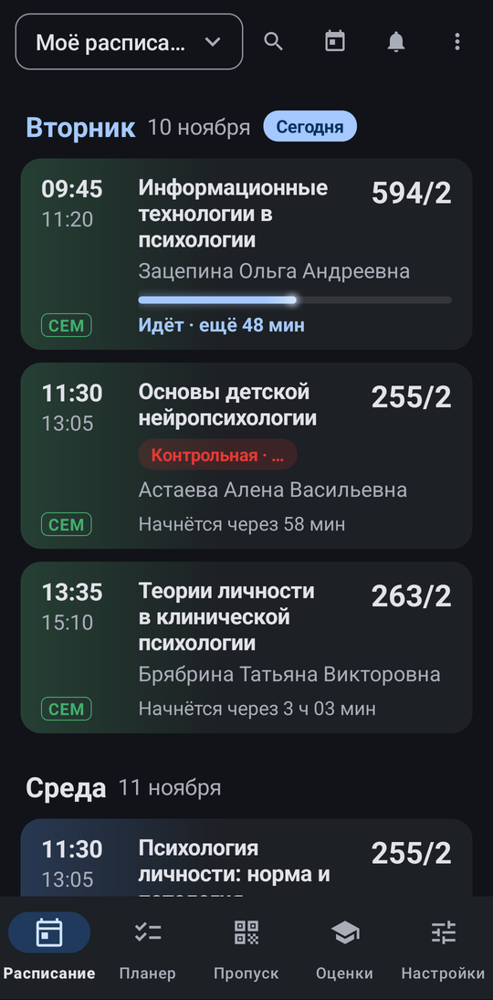
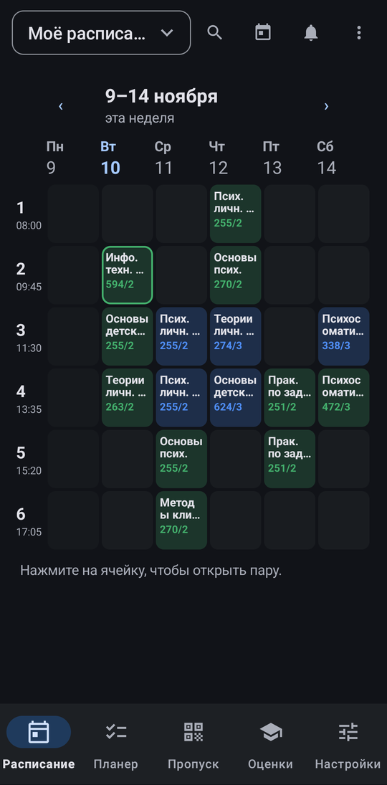
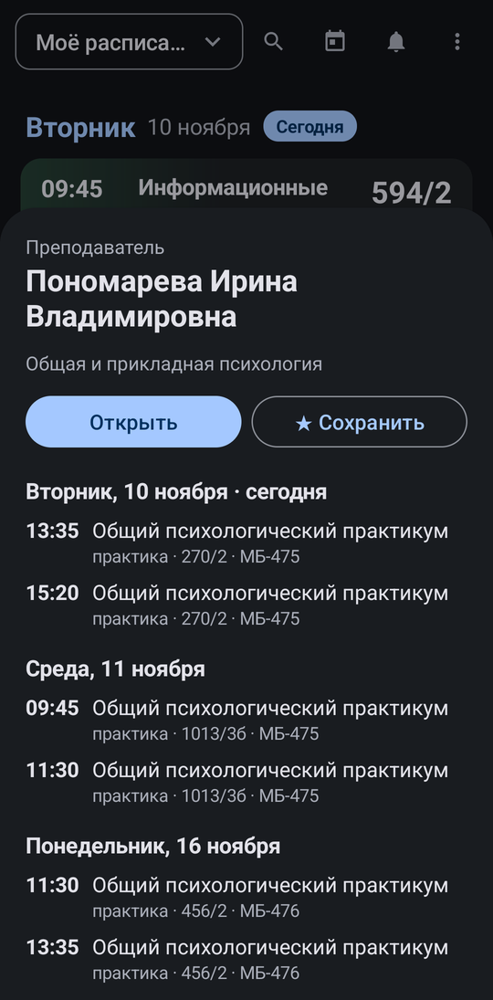
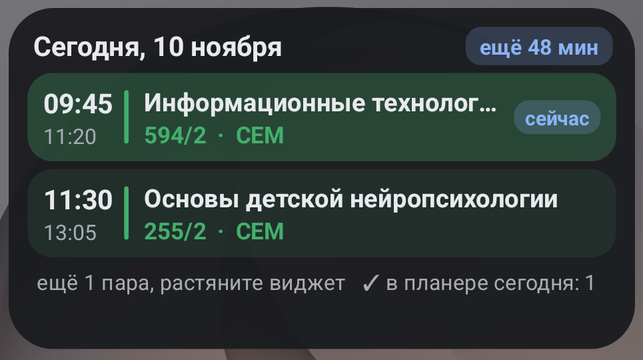
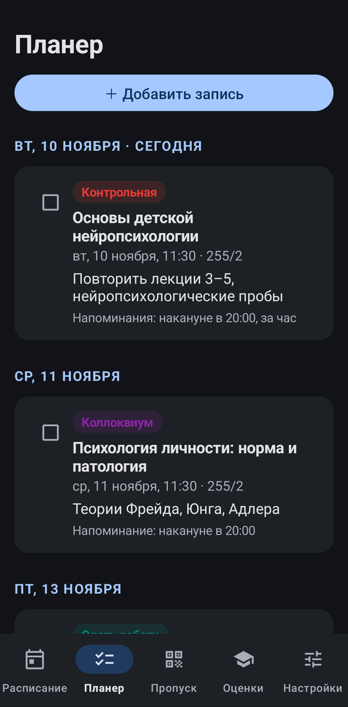
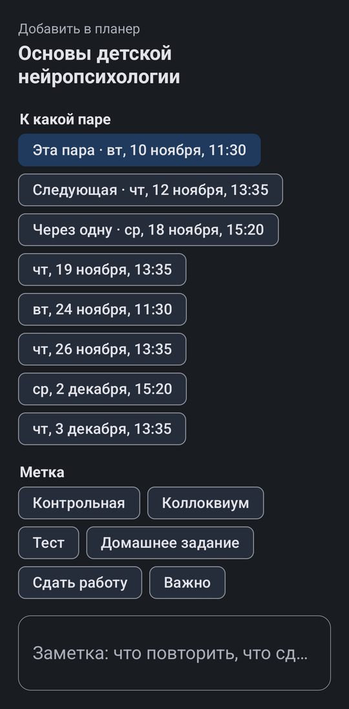
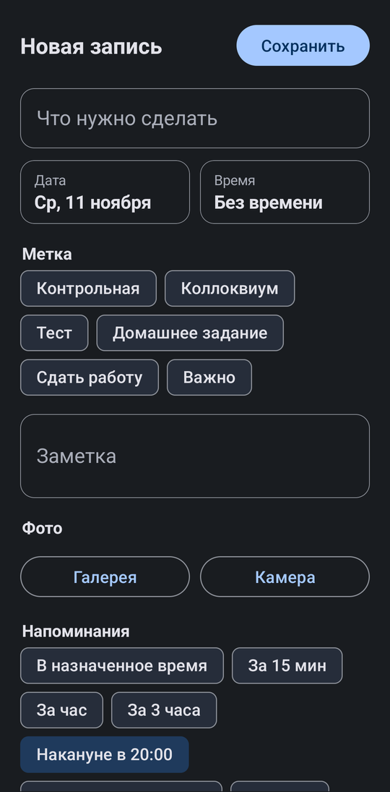
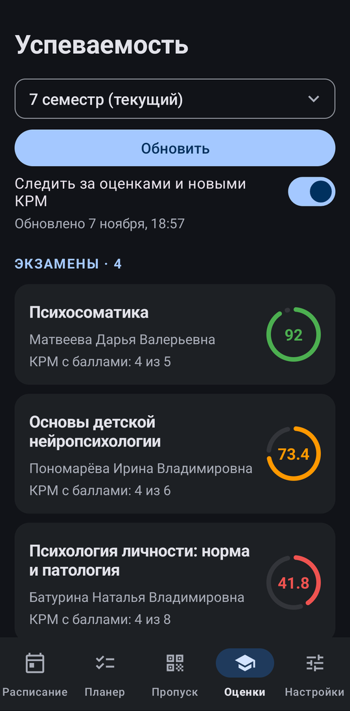
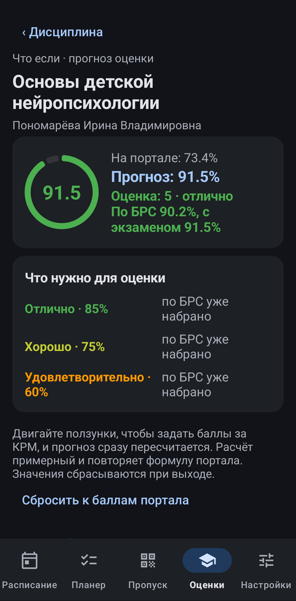

<div align="center">

# SUSU Tool

**Расписание, планер, оценки и пропуск ЮУрГУ в одном приложении для Android**

[](https://github.com/esko30/susu-tool/releases/latest)


Неофициальное приложение для портала [online.susu.ru](https://online.susu.ru) (ЮУрГУ-Онлайн)

</div>

---

## Расписание

Лента пар открывается на сегодняшнем дне. У идущей пары есть полоса прогресса и отсчёт до конца, у следующих видно, сколько осталось до начала. Между парами показываются свободные окна. Расписание можно смотреть и неделей, сеткой по парам и дням.

<p align="center">
  
  
  
</p>

- Поиск групп, преподавателей и аудиторий прямо по мере ввода.
- Нажатие на аудиторию, преподавателя или группу открывает их расписание.
- Сохранённые расписания работают без интернета.
- Уведомления о переносах и отменах, список всех изменений.
- Пары можно добавить в календарь телефона: для каждого расписания создаётся отдельный календарь.

## Виджет

Ближайшие пары на главном экране в том же стиле, что и в приложении. Идущая пара подсвечена, сверху отсчёт до конца или до начала. Растяните виджет, чтобы видеть больше пар.

<p align="center">
  
</p>

## Планер

Нажмите на пару и отметьте контрольную, коллоквиум, тест или домашнее задание: к этой паре, следующей или через одну. Можно добавить и свою запись с любой датой и временем, прикрепить фото доски или задания и поставить сколько угодно напоминаний.

<p align="center">
  
  
  
</p>

## Оценки и «Что если»

Рейтинг по каждой дисциплине и баллы за все КРМ, разбитые по форме контроля. Уведомления о новых КРМ и изменении оценок.

«Что если» считает прогноз по формуле портала: двигайте ползунки будущих баллов и смотрите, какая выйдет оценка по БРС и с экзаменом при отказе от БРС, и сколько нужно набрать на оставшихся КРМ или на экзамене.

<p align="center">
  
  
  
</p>

## Пропуск

QR-код пропуска на отдельной вкладке. Яркость сама выкручивается на максимум, экран не гаснет, а код открывается и без интернета.

> На скриншотах демо-данные: имя, номер пропуска, оценки и записи планера выдуманы.

---

**Обратная сторона: если портал изменится**

У приложения нет своего сервера, поэтому оно полностью зависит от того, как устроен сайт университета. Если университет что-то поменяет на портале, приложение может показывать данные неверно или не показывать их вовсе.

Это честная цена бессерверной схемы. Взамен твои данные не проходят ни через чьи руки, кроме университета, и это максимум безопасности, который вообще возможен. Разработчик старается исправлять такие поломки быстро: обновление придёт прямо в приложение.

Если что-то выглядит странно, сверься с online.susu.ru и напиши разработчику.

---

## Установка

1. Скачайте `SUSU-Tool-*.apk` со страницы [последнего релиза](https://github.com/esko30/susu-tool/releases/latest).
2. Откройте файл на телефоне и разрешите установку из этого источника.
3. Войдите тем же логином и паролем, что и на online.susu.ru.

Обновления приходят прямо в приложение: оно само проверяет новые версии на GitHub.

## Данные и безопасность

Приложение работает через те же запросы, что и ЮУрГУ-Онлайн (online.susu.ru): вход, расписание, поиск, успеваемость и пропуск. Других серверов у приложения нет, данные не передаются никуда, кроме online.susu.ru. Аналитики и рекламы нет. Как пример, свою почту можно читать на сайте, а можно в приложении «Почта» на телефоне. Письма те же, ящик тот же, пароль твой. Приложение просто удобнее показывает. SUSU Tool точно так же устроен для портала ЮУрГУ.

- Логин и пароль хранятся в зашифрованном хранилище Android (ключ в Android Keystore).
- Расписания, оценки, записи планера и фото лежат в личной папке приложения, недоступной другим приложениям.
- Всё удаляется кнопкой «Выйти и удалить все данные и календари» или вместе с приложением.

**Все права на систему ЮУрГУ-Онлайн и её данные принадлежат ФГАОУ ВО «ЮУрГУ (НИУ)». Разработчик SUSU Tool не связан с университетом и ни на что не претендует.**

---

## Для разработчиков

Kotlin, Android Views и Material 3, без сторонних серверов.

```
gradlew testReleaseUnitTest assembleRelease
```

Нужны JDK 17 и Android SDK. Ключ подписи берётся из `../signing/keystore.properties` (вне репозитория); без него сборка подписывается debug-ключом. Тесты покрывают расчёт рейтинга и прогноза, разбор ответов портала, напоминания и логику ленты.

### Выпуск обновления

1. Увеличить `versionCode` и `versionName` в `app/build.gradle.kts`, добавить пункт в `WhatsNew.kt`.
2. Закоммитить и поставить тег `v<versionName>`, например `git tag v2.2 && git push origin main v2.2`.
3. GitHub Actions прогонит тесты, соберёт подписанный APK и опубликует релиз.

Секреты репозитория для подписи: `KEYSTORE_BASE64`, `SIGNING_STORE_PASSWORD`, `SIGNING_KEY_ALIAS`, `SIGNING_KEY_PASSWORD`.
